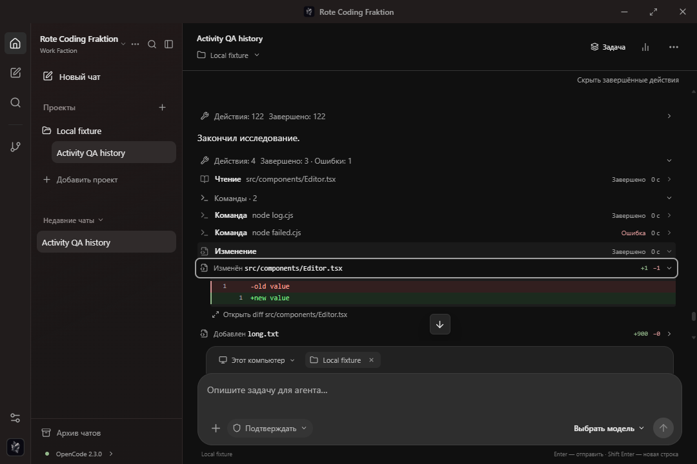
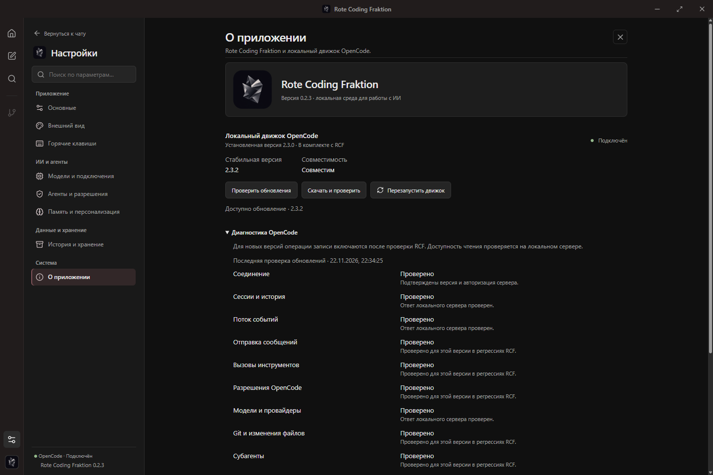

<p align="center">
  
</p>

<h1 align="center">Rote Coding Fraktion</h1>

<p align="center">
  A Windows desktop workspace for AI-assisted coding with OpenCode.
</p>

<p align="center">
  <a href="CHANGELOG.md#023--current-source">Version 0.2.3</a> ·
  <a href="#getting-started">Getting started</a> ·
  <a href="#documentation-and-license">Documentation</a>
</p>

RCF brings local projects, agent sessions, tool approvals, and Git changes together in one desktop app.



*Work Faction in a local UI test project.*

## Features

- **Coding and chat.** Use Work Faction for project-based agent sessions and Chat Faction for conversations without tools. Search session history, pin chats, and use the conversation outline to navigate long threads.
- **Tool activity and approvals.** Follow streaming responses, inspect grouped tool calls and command output, review file changes, and respond to permission requests.
- **Git and task controls.** Review diffs, stage selected files, create branches and commits, and isolate tasks in Git worktrees. Remote Git operations require confirmation. Task agents, read-only review, and conversation checkpoints support longer work. Restoring a conversation checkpoint leaves project files as they are.
- **Models and connections.** Configure providers such as OpenRouter, choose models, attach images with compatible models, and prepare PDFs locally.
- **Local memory.** Manage shared and project-specific memory records and include them in session context when memory is enabled.

## Getting started

The current source version is **0.2.3**. Run it from source on **Windows x64** with **Node.js 22.22 or newer in the 22.x line**, npm, and Git on `PATH`.

```powershell
git clone https://github.com/Karg-Nacht/Rote-Coding-Fraktion.git
cd Rote-Coding-Fraktion
npm ci
npm run setup
npm run dev
```

The repository disables automatic npm lifecycle scripts. The explicit setup step installs the Electron runtime and the bundled OpenCode CLI. Development uses a separate profile under `.runtime/desktop`.

In the app, open **Settings → Models and connections** to configure a provider, then add a local project in **Work Faction**. Model capabilities and availability depend on your provider. Creating draft pull requests requires an authenticated GitHub CLI.

### Windows packaging

After setup, run `npm run package` to build unsigned Windows x64 Portable and NSIS Setup executables locally in `release/`. Use `npm run package:dir` for an unpacked build. Portable and Setup downloads for 0.2.3 are currently unavailable. Local builds require launch verification before distribution.

## Technology stack

- **Desktop** — Electron and a typed IPC bridge
- **Interface** — React, TypeScript, and Vite
- **Agent runtime** — OpenCode CLI and TypeScript client
- **Local storage** — SQLite for app preferences, drafts, and memory
- **Windows packaging** — electron-builder with Portable and NSIS targets

OpenCode handles sessions, model requests, tools, credentials, and event streaming. The Electron main process supervises the engine. See the [architecture notes](docs/ARCHITECTURE.md) for implementation details.

### OpenCode compatibility

RCF 0.2.3 bundles **OpenCode CLI 2.3.0** and pins the **TypeScript client to 2.3.0**. The engine manager also supports **OpenCode CLI 2.3.2**, subject to runtime compatibility checks.

Use **Settings → About** to inspect the engine version and diagnostics. RCF checks the engine API before enabling operations. Other engine versions may have limited functionality.



*OpenCode engine management in the 0.2.3 UI test profile.*

## Data and permissions

- Packaged builds use `%APPDATA%\Forge Agent` by default, including Portable builds. To use a separate profile, set `RCF_DATA_DIR` to an absolute path.
- OpenCode manages provider credentials in the app profile. Keep profiles, credentials, attachments, and local databases outside version control.
- OpenCode permissions govern tool actions. Allowed commands run with the signed-in user's OS privileges. Use OS-level isolation for untrusted projects.

## Development checks

```powershell
npm test
npm run build
npm run test:engine
npm run test:engine-manager-ui
```

The engine manager UI check uses a separate Electron profile and local test fixtures. The [live contract script](scripts/opencode-contract-live.mjs) takes a verified OpenCode executable and its exact version as arguments.

## Documentation and license

- [Changelog](CHANGELOG.md) and [historical verification](VERIFICATION.md)
- [Architecture notes](docs/ARCHITECTURE.md) and [chat menu reference](docs/CHAT-MENU.md)
- [MIT license for RCF](LICENSE), [bundled OpenCode license](resources/OPENCODE-LICENSE), and [third-party notices](THIRD_PARTY_NOTICES.md)

Historical reports retain paths to the local verification outputs and Windows binaries from their original runs.
